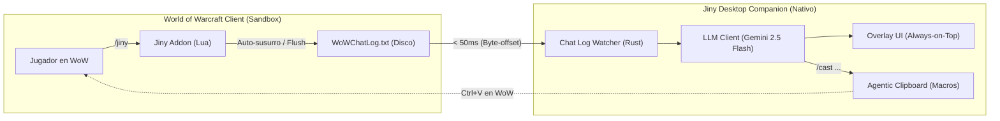

# Expediente Documental: Jiny Companion (WoW Classic Era 1.15.x)

> [!NOTE]
> Este documento consolida la arquitectura técnica, catálogo formal de requerimientos (RF y RnF), lecciones aprendidas durante los prototipos, desglose de hitos evolutivos y la guía para preservar el proyecto de forma ordenada en Git.

---

## 1. Visión del Producto

**Jiny** es un copiloto de inteligencia artificial en tiempo real para jugadores de *World of Warcraft Classic Era (1.15.x)*. Su misión es eliminar la fricción de tener que salir del juego (Alt-Tab) para consultar bases de datos externas (Wowhead, foros, guías de talentos, etc.), permitiendo consultar misiones, ubicaciones de PNJs, rutas de leveo y generar macros listas para usar mediante lenguaje natural.



---

## 2. Catálogo de Requisitos Funcionales (RF)

| ID | Nombre | Descripción | Estado |
| :--- | :--- | :--- | :--- |
| **RF-01** | **Captura In-Game de Consultas** | El jugador puede formular consultas mediante comando de barra (`/jiny <texto>`) o a través de la caja de texto del marco in-game. | Implementado |
| **RF-02** | **Transporte Addon ➔ Desktop** | El addon empaqueta la consulta con metadatos (`[JINY_Q#<id>#<lang>]`) y fuerza su volcado al archivo de registro para lectura externa inmediata. | En ajuste |
| **RF-03** | **HUD de Escritorio en Tiempo Real** | Ventana compañera flotante (*Always-on-Top*), independiente del motor de WoW, que muestra las respuestas en menos de 2.5 segundos sin requerir `/reload`. | Implementado |
| **RF-04** | **Grounding Específico Vanilla 1.15.x** | El motor de IA aplica reglas estrictas para evitar alucinaciones de expansiones posteriores (WotLK, Retail, SoD, runas o árboles de talentos de mascotas). | Implementado |
| **RF-05** | **Memoria Conversacional Multi-Turno** | Mantenimiento de contexto en memoria de los últimos 6 turnos conversacionales para responder a repreguntas ("¿y dónde se entrega?", "¿qué nivel pide?"). | Implementado |
| **RF-06** | **Detección y Copiado Automático de Macros** | Detección sintáctica de bloques `/cast`, `/use`, `#showtooltip` en la respuesta, con botón destacado de copiado y modo *Auto-Copy* al portapapeles de Windows. | Implementado |
| **RF-07** | **Sincronización Diferida In-Game** | Las respuestas generadas se serializan en `CompanionData.lua` con IDs universales únicos (`desk-<epoch>-<id>`) para cargarse dentro del marco de WoW al iniciar sesión o tras `/reload`. | Corregido |
| **RF-08** | **Modo de Diagnóstico / Eco (RF1)** | Capacidad de desconectar temporalmente las llamadas externas a Gemini para validar exclusivamente la integridad y latencia del enlace de transporte local. | Implementado |

---

## 3. Catálogo de Requisitos No Funcionales (RnF)

| ID | Nombre | Criterio de Aceptación / Restricción |
| :--- | :--- | :--- |
| **RnF-01** | **Cumplimiento Estricto ToS Blizzard** | **Cero inyección de memoria o hooks DLL.** Toda interacción con WoW se realiza respetando la caja de arena de la API oficial de Addons y archivos de texto estándar del SO. |
| **RnF-02** | **Rendimiento y Huella Ligera** | El companion de escritorio debe consumir < 120 MB de memoria RAM en reposo y < 1% de CPU, garantizando que los FPS del juego no se vean afectados. |
| **RnF-03** | **Tolerancia a Fallos y Sanitización** | Si la API de IA falla por red o cuota, el error devuelto a la UI debe ser comprensible y sanitizado (ocultando tokens o claves privadas de API). |
| **RnF-04** | **Privacidad Absoluta del Chat** | El lector de logs solo analiza líneas precedidas por el identificador de protocolo `[JINY_Q#`. Cualquier otro mensaje (susurros privados, hermandad, banda) se ignora en memoria. |
| **RnF-05** | **Despliegue de 1 Clic** | La solución debe operar como un ejecutable autocontenido sin requerir que el usuario instale intérpretes de Python, entornos virtuales o dependencias pesadas. |

---

## 4. Agrupación de Ideas e Hitos (Roadmap Evolutivo)

```mermaid
timeline
    title Hoja de Ruta Evolutiva de Jiny
    section Hito 1 : Prototipo & Core
        v0.1 - v0.4 : Addon Lua con diseño Pergamino/DarkGlass : Prototipo en Python con SQLite local y Gemini
    section Hito 2 : Rust Nativo
        v0.5 : Migración a Rust (eframe/egui) : Agentic Clipboard : Anti-alucinaciones Vanilla
    section Hito 3 : Enlace Resiliente (Actual)
        v0.6 : Bypass RF1 (Validación de Transporte) : Corrección de IDs únicos contra descarte silencioso : Launcher 1 Clic
    section Hito 4 : Experiencia Inmersiva
        v0.7 : Síntesis de voz Edge-TTS (Jiny te habla en cascos/Discord) : Mini-Overlay translúcido click-through
    section Hito 5 : Release Oficial
        v1.0 : Instalador MSI / Zip para CurseForge : Publicación de release en GitHub
```

### Detalle de los Hitos:

* **Hito 1 (Fundación v0.1 - v0.4):** Validación de la interfaz en WoW, soporte de idiomas (esES, enUS, itIT), almacenamiento de SavedVariables y pruebas iniciales de IA.
* **Hito 2 (Nativo v0.5):** Reemplazo del entorno de Python por un binario Rust ultra-rápido, gestión de portapapeles automática y delimitación estricta de conocimiento de Vanilla.
* **Hito 3 (Resiliencia v0.6 - En curso):** Diagnóstico de transporte en tiempo real, resolución de bugs de colisión de IDs en `JinyDB.processedIds` y diseño de HUD flotante.
* **Hito 4 (Audio & Accesibilidad v0.7):** Módulo de voz para que las respuestas largas puedan escucharse mientras el jugador sigue en combate o recolectando.
* **Hito 5 (Distribución v1.0):** Empaquetado final para la comunidad de WoW Classic.

---

## 5. Instrucciones para Salvar y Congelar el Proyecto en Git

Para garantizar que ningún archivo ni avance se pierda, sigue estos pasos desde la terminal de trabajo:

### Paso 1: Verificar y consolidar la rama de trabajo
```powershell
cd "D:\Games\Bnet\World of Warcraft\jiny"
git status
```

### Paso 2: Crear un Tag de Respaldo Semántico
Congelar el estado actual de la PoC con una etiqueta identificable:
```powershell
git tag -a "poc-v0.6-checkpoint" -m "Checkpoint de PoC v0.6: Enlace lineal, IDs unicos corregidos y modo RF1"
```

### Paso 3: Subir todos los cambios y tags al repositorio remoto
```powershell
git push origin poc/v0.6-resilient-companion --tags
```

### Paso 4: Exportar este Expediente al Repositorio Local
Copiar este expediente documental directamente a la carpeta `docs/` de tu repositorio para que viaje versionado con el código:
```powershell
New-Item -ItemType Directory -Force -Path "docs"
Copy-Item "C:\Users\ysant\.gemini\antigravity\brain\62c9dd1c-ebca-4b44-bac0-b57ed0bc2008\expediente_proyecto_jiny.md" -Destination "docs\EXPEDIENTE_ARQUITECTURA.md" -Force
git add docs/EXPEDIENTE_ARQUITECTURA.md
git commit -m "docs: registrar expediente documental con RF, RnF y hoja de ruta"
git push origin poc/v0.6-resilient-companion
```

---

> [!TIP]
> **Próxima decisión de diseño recomendada:**  
> Una vez validado el transporte físico (Addon ➔ Log ➔ Desktop), reactivar el interruptor de Gemini en la barra superior para completar la prueba de extremo a extremo con el modelo `gemini-2.5-flash`.
